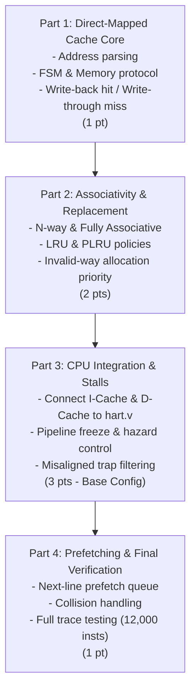

# EEL 4768: Phase 5 – Cache Implementation Plan

This document breaks down the implementation of **Phase 5 (Cache Architecture and CPU Integration)** into **4 distinct, incremental, and testable milestones**. It is designed to help the team divide the workload, avoid simultaneous debugging of cache and pipeline logic, and hit all 7 rubric points.

---

## 1. Project Overview & Grading Rubric

In Phase 5, we design a parameterizable instruction and data cache module ([cache.v](file:///home/twigs/SAG/EEL4768_RISC-V_Project/phase_5/skeletons/cache.v)) and integrate two instances into the 5-stage pipelined CPU ([hart.v](file:///home/twigs/SAG/EEL4768_RISC-V_Project/phase_5/skeletons/hart.v)).

### Point Breakdown (Total: 7 Points)

| Category | Points | Description / Requirements |
| :--- | :---: | :--- |
| **Base Configuration** | 3 pts | LRU, Fully Associative (128 ways for 16 KB / 128 B), 16 KB size, 128 B blocks, no prefetch, integrated into CPU pipeline with stall logic. |
| **Direct Mapped** | 1 pt | Functional when `NUM_WAYS = 1`. |
| **Set Associative** | 1 pt | Functional for arbitrary way counts dividing the total blocks (e.g., 2-way, 4-way, 8-way). |
| **PLRU** | 1 pt | Pseudo-LRU tree replacement policy when `EVICT_POLICY = 1`. |
| **Next-Line Prefetching** | 1 pt | Pipelined next-line prefetch on load misses when `PREFETCH_EN = 1`. |
| **Total** | **7 pts** | |

---

## 2. Critical Verilog Coding Rules

The autograder automatically rejects submissions (assigning **0 points**) if any of these rules are violated:

1. **Synthesizable Math Only:** `*`, `/`, `%`, `**` are strictly forbidden on runtime signals. They may **only** be used in `parameter`, `localparam`, wire widths, and `generate` indices.
2. **Shift Operations:** Only shift by a literal constant (e.g., `x << 3`). Shifts by parameters or signals (e.g., `x << SOME_PARAM`) are rejected—use part-selects or concatenations instead.
3. **Combinational Logic:** No `if/else` in combinational `always @(*)` blocks. Use ternary operators (`?:`) or `case` statements.
4. **No Procedural Loops:** `for`, `while`, `repeat` inside `always` blocks are forbidden. Use `generate` loops instead, or write instances out.
5. **No Simulation Constructs / System Tasks:** No `#delay`, `wait`, `$display`, `$finish`, `$stop`, `$readmemh`, or file I/O inside submission files. Only constant functions like `$clog2` are allowed.
6. **Compiler Directives:** No `` `include ``, `` `ifndef ``, `` `elsif ``, or `` `ifdef `` (except the skeleton's `` `ifdef RISCV_FORMAL ``).
7. **Single Clock, Synchronous Reset:** Every sequential block must be strictly:
   ```verilog
   always @(posedge i_clk) begin
       if (i_rst) begin
           // reset values
       end else begin
           // active logic
       end
   end
   ```

---

## 3. Four-Part Implementation Roadmap



---

### Part 1: Core Cache Architecture & Direct-Mapped Baseline

> **Goal:** Create the fundamental memory array, addressing logic, memory handshake, and cache FSM for `NUM_WAYS = 1` (Direct Mapped). Validate completely with a standalone testbench before touching the CPU.
> **Rubric Reward:** Direct mapped (1 pt).

#### Key Technical Requirements:
* **Address Decomposition:**
  * Byte Offset: `OFFSET_BITS = $clog2(BLOCK_SIZE)`
  * Set Index: `SET_BITS = $clog2((CACHE_SIZE * 1024) / (BLOCK_SIZE * NUM_WAYS))`
  * Tag: `TAG_BITS = 32 - SET_BITS - OFFSET_BITS`
  * *Note: Address bits split as `[31 : 32 - TAG_BITS]` for tag, `[OFFSET_BITS + SET_BITS - 1 : OFFSET_BITS]` for index, and `[OFFSET_BITS - 1 : 0]` for byte offset.*
* **Cache Storage:**
  * Valid bits (`NUM_SETS` entries), Dirty bits (`NUM_SETS` entries), Tag memory, and Data memory (`BLOCK_SIZE * 8` bits per line).
* **Cache Controller FSM:**
  1. **Lookup / Compare:** Check valid bit and compare tag against address.
  2. **Read Hit:** Extract 32-bit word using the byte offset and assert `o_ready = 1`.
  3. **Read Miss:** 
     * If line is dirty: write whole line back to main memory (`o_mem_wr = 1`, `o_mem_wr_be = {BLOCK_SIZE{1'b1}}`).
     * Issue memory read request (`o_mem_rd = 1`, single-cycle pulse).
     * Wait for `i_mem_valid` (arbitrary cycle delay from memory; never hardcode cycle counts!).
     * Store new block into cache line, mark clean (`dirty = 0`, `valid = 1`), and output word.
  4. **Store Hit (Write-Back):**
     * Update specified bytes in the block using `i_mask` and `i_wdata`.
     * Mark block as `dirty = 1`.
  5. **Store Miss (Write-Through, No-Allocate):**
     * Do **not** bring line into cache.
     * Forward write straight to main memory: `o_mem_wr = 1`, line address = `i_addr`, data placed within block at byte offset, `o_mem_wr_be` asserted only for masked bytes.

#### Part 1 Deliverables & Verification:
* Standalone unit testbench: `cache_tb.v` with a simulated main memory model supporting variable latency.
* **Test Checklist:**
  - [ ] Read hit after cold miss
  - [ ] Store hit correctly updates block and sets dirty bit
  - [ ] Store miss writes directly to memory with exact byte enables and doesn't allocate
  - [ ] Eviction of a clean line does not trigger memory write
  - [ ] Eviction of a dirty line triggers full-block write-back before loading new line

---

### Part 2: Multi-Way Associativity & Replacement Policies (LRU & PLRU)
> **Goal:** Expand `cache.v` to support arbitrary `NUM_WAYS` (2-way, 4-way, 8-way, and Fully Associative), implementing both LRU and PLRU policies.
> **Rubric Reward:** Set associative (1 pt) + PLRU (1 pt).

#### Key Technical Requirements:
* **Multi-Way Tag Checking:**
  * Instantiate/generate parallel comparators across all `NUM_WAYS` ways.
  * Determine hit status: `hit = |way_hit_bus`.
  * Multiplex the winning way's data to the CPU.
* **Victim Selection Logic (on a Miss):**
  1. **Invalid-Way Priority:** Section 4.11 dictates that *the lowest-numbered invalid way is always used before evicting a valid one*.
  2. **LRU Policy (`EVICT_POLICY = 0`):**
     * Maintain access order for each set.
     * On every hit or fill, move the accessed way to the Most Recently Used (MRU) position.
     * On eviction (when all ways are valid), replace the Least Recently Used (LRU) way.
  3. **PLRU Policy (`EVICT_POLICY = 1`):**
     * Maintain a binary decision tree of bits for each set (e.g., for 4 ways, a 3-bit tree; for $N$ ways, $N-1$ bits).
     * **On hit/fill:** Flip tree nodes along the access path so they point *away* from the accessed way.
     * **On miss/victim search:** Traverse the tree according to current bit directions to find the victim way. *Do not update tree bits during victim lookup!*
* **Fully Associative Support:**
  * When `NUM_WAYS == (CACHE_SIZE * 1024) / BLOCK_SIZE`, the number of sets is 1 (`SET_BITS = 0`). Verify the address parsing does not produce negative or zero-width slicing errors.

#### Part 2 Deliverables & Verification:
* Extend `cache_tb.v` with multi-way test patterns.
* **Test Checklist:**
  - [ ] Cold misses fill ways in order (Way 0, Way 1, Way 2...) before any eviction occurs
  - [ ] LRU correctly evicts the least recently accessed way on conflict
  - [ ] PLRU correctly follows the binary tree bit-flipping and traversal model
  - [ ] Verifies cleanly under 2-way, 4-way, and fully-associative parameterizations

---

### Part 3: CPU Integration & Pipeline Stall Logic (`hart.v`)
> **Goal:** Integrate two `cache.v` instances into the pipelined CPU, handle memory latency stalls in `IF` and `MEM`, properly route traps, and pass the official smoke test.
> **Rubric Reward:** Base configuration (3 pts).

#### Key Technical Requirements:
* **Cache Instantiations in `hart.v`:**
  * **Instruction Cache:** Placed in the Fetch (`IF`) stage. Reads only (`i_ren = 1`, `i_wen = 0`). Line address from `pc`.
  * **Data Cache:** Placed in the Memory (`MEM`) stage. `i_ren = mem_read`, `i_wen = mem_write`, `i_addr = alu_result`, `i_wdata = rs2_forwarded`, `i_mask = byte_mask`.
  * Memory-side ports (`o_imem_*`, `o_dmem_*`) wired directly to the top-level ports of `hart.v`.
* **Pipeline Freeze / Stall Control:**
  * When `!icache_ready` (I-cache miss):
    * Stall the `IF` stage (hold PC and instruction fetch register).
  * When `!dcache_ready` (D-cache miss):
    * Freeze all pipeline registers up to `MEM` (WB finishes normally, MEM holds the memory instruction, EX/ID/IF freeze and hold their values).
  * **Crucial Rule:** *No pipeline flush may happen while the cache is waiting for memory.* The pipeline must stay completely frozen until the stall ends.
* **Misaligned Memory Accesses & Traps (Section 4.10.1):**
  * Trapped instructions (misaligned loads/stores) must **never reach the cache**.
  * Suppress `i_ren` and `i_wen` if `trap` is asserted so that misaligned instructions cause *no lookup, no miss, no line read, and no main memory write*.
* **Retire Interface:**
  * `o_retire_valid` must be driven low during stall cycles when no instruction retires.
  * Ensure all `o_retire_*` ports strictly match Phase 4 definitions and timing.

#### Part 3 Deliverables & Verification:
* Run the official compilation and smoke script:
  ```bash
  bash scripts/check_design.sh smoke .
  ```
* **Test Checklist:**
  - [ ] Design compiles without errors under `iverilog -g2005`
  - [ ] No prohibited system tasks or preprocessor directives detected
  - [ ] Passes 10-instruction smoke test program (`smoke_program.hex`)
  - [ ] Correctly asserts `o_retire_halt` on `ebreak`

---

### Part 4: Next-Line Prefetching & Full Trace Verification
> **Goal:** Implement the next-line prefetch engine (`PREFETCH_EN = 1`), handle memory request pipelining and collisions, and verify against the full 12,000-instruction trace.
> **Rubric Reward:** Next line prefetching (1 pt) -> Completes **7 / 7 points**.

#### Key Technical Requirements:
* **Prefetch Trigger & Address Rules (Section 4.8):**
  * **Trigger:** Triggered **only on a load miss**. Hits never prefetch; store misses (write-through) never prefetch.
  * **Address Calculation:** Prefetch address is `miss_address + BLOCK_SIZE` (i.e. `{tag, index} + 1`). Ensure index overflow properly carries into the tag!
  * **Skipping:** If the next line is already present in the cache, skip the prefetch request.
* **Pipelined Memory Requests & Early Resume:**
  * Send demand request in Cycle $N$.
  * Send prefetch request in Cycle $N+1$ (memory pipeline handles overlapped accesses).
  * **Resume CPU Early:** When the demand block arrives, supply data to the CPU and resume CPU execution immediately—do **not** keep the CPU stalled waiting for the prefetch block.
  * When the prefetched block arrives, write it into the cache as clean and mark it MRU.
* **Prefetch Collision Handling (Section 4.8.1):**
  * If a prefetched line arrives at the exact same cycle the CPU is accessing that set:
    * Prefetch line has priority.
    * **Option B (Recommended):** Stall the CPU access for 1 cycle while updating the cache with the prefetch line, then allow the CPU access on the next cycle.
* **Full Trace Validation:**
  * Run [traces/random_program.hex](file:///home/twigs/SAG/EEL4768_RISC-V_Project/phase_5/traces/random_program.hex) in your top-level testbench.
  * Compare simulated data memory against [traces/random_dmem.hex](file:///home/twigs/SAG/EEL4768_RISC-V_Project/phase_5/traces/random_dmem.hex).

#### Part 4 Deliverables & Verification:
* **Test Checklist:**
  - [ ] Prefetch correctly calculates `{tag, index} + 1` across index boundary
  - [ ] Prefetch is skipped if block already exists in cache
  - [ ] Collision priority works without corrupting CPU read or cache state
  - [ ] All 16,384 words in data memory match `random_dmem.hex` perfectly across all configurations:
    1. Base Config: 16 KB, 128 B, Fully Assoc (128 ways), LRU, Prefetch Off
    2. Direct Mapped: 64 KB, 64 B, 1 way, LRU, Prefetch Off
    3. Set Associative: 16 KB, 64 B, 4 ways, LRU, Prefetch Off
    4. PLRU: 16 KB, 64 B, 4 ways, PLRU, Prefetch Off
    5. Prefetch Enabled: 16 KB, 128 B, Fully Assoc, LRU, Prefetch On

---

## 4. Suggested Team Task Division

| Teammate / Role | Primary Responsibilities | Secondary / Pair Programming |
| :--- | :--- | :--- |
| **Member 1: Cache Core Lead** | Part 1 (Address slicing, Cache FSM, memory read/write protocol) | Assist on Part 2 multi-way muxing |
| **Member 2: Policy & Replacement Lead** | Part 2 (Way generation, LRU tracking state, PLRU binary tree) | Assist on Part 4 prefetch victim selection |
| **Member 3: CPU Integration Lead** | Part 3 (`hart.v` cache instantiations, stall engine, trap filtering) | Setup top-level memory testbench harness |
| **Member 4: Prefetch & Verification Lead** | Part 4 (Prefetch queue, collision resolver, full trace regression) | Build `cache_tb.v` and smoke test automation |


---

## 5. Verification Commands Quick Reference

### 1. Compile Design Against Smoke Harness
```bash
iverilog -g2005 -s hart_smoke_tb -o sim \
    phase_5/scripts/hart_smoke_tb.v \
    hart.v cache.v alu.v imm.v rf.v decoder.v
```

### 2. Run Smoke Program
```bash
vvp -n sim +program=phase_5/scripts/smoke_program.hex
```

### 3. Run Automated Linter & Setup Check
```bash
bash phase_5/scripts/check_design.sh test .
```

### 4. Run Full Trace Test
```bash
iverilog -g2005 -s hart_tb -o sim \
    hart_tb.v hart.v cache.v alu.v imm.v rf.v decoder.v
vvp -n sim +program=phase_5/traces/random_program.hex
```
*(Then compare data memory against `phase_5/traces/random_dmem.hex`)*
